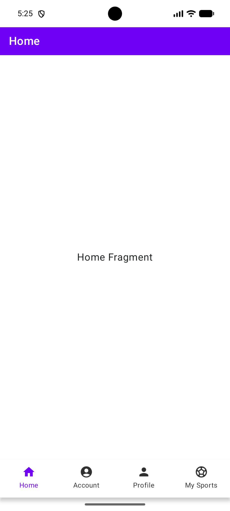
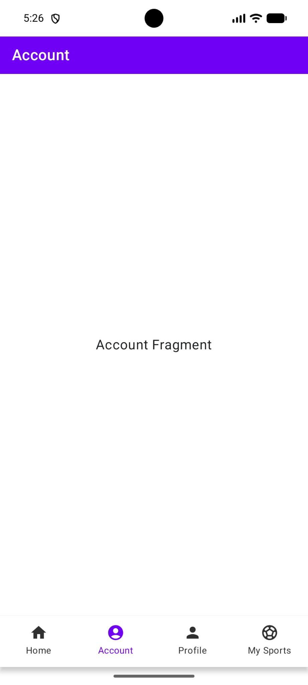
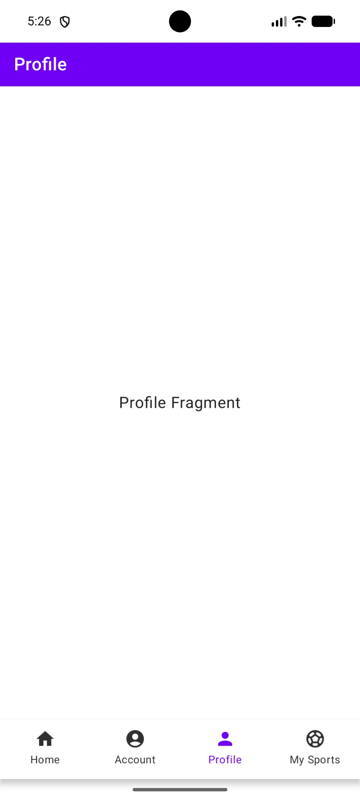
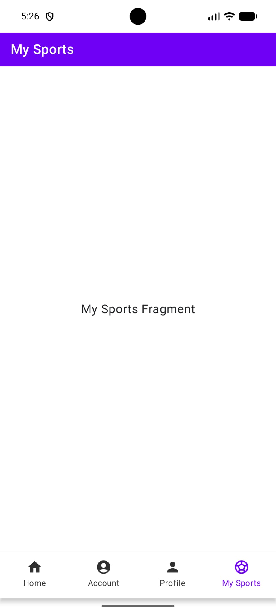

# SportsApp

A Jetpack Compose sports application with a purple Material-style interface and bottom navigation for the app's primary destinations.

## Features

- Purple edge-to-edge app bar
- Bottom navigation with four destinations
- Selected and unselected navigation icon states
- State-preserving tab selection
- Responsive Compose layout
- Preview-ready UI components

## Navigation

The app currently includes these top-level destinations:

| Destination | Description |
| --- | --- |
| Home | Main landing screen for the app |
| Account | Account-related content |
| Profile | User profile content |
| My Sports | Sports-related content and preferences |

Each destination currently displays its own centered fragment placeholder and updates the app bar title when selected.

## Screenshots

Screenshots are stored in [`screenshots/navigation`](screenshots/navigation).

### Home



### Account



### Profile



### My Sports



## Technology Stack

- Kotlin
- Jetpack Compose
- Material 3
- Android Gradle Plugin
- Gradle version catalogs

## Project Structure

```text
SportsApp/
├── app/
│   └── src/main/java/com/example/sportsapp/
│       ├── MainActivity.kt
│       └── ui/theme/
├── screenshots/
│   └── navigation/
├── gradle/
├── build.gradle.kts
└── settings.gradle.kts
```

## Requirements

- Android Studio
- Android SDK configured through `local.properties`
- Android SDK 37
- A device or emulator running Android API 33 or higher

## Build and Run

Clone or open the project in Android Studio, allow Gradle sync to complete, and run the `app` configuration on an emulator or connected Android device.

To build the debug APK from a terminal on Windows:

```powershell
.\gradlew.bat :app:assembleDebug
```

The generated APK is located at:

```text
app/build/outputs/apk/debug/app-debug.apk
```

## Package Information

```text
Application ID: com.example.sportsapp
Namespace: com.example.sportsapp
Version: 1.0
```

## License

This project is intended for educational and development purposes.
